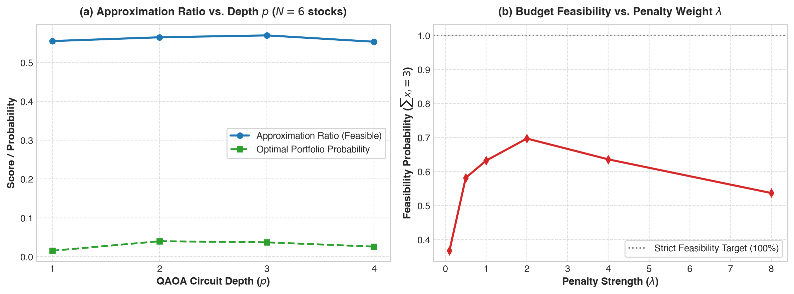
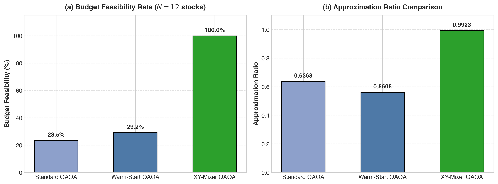
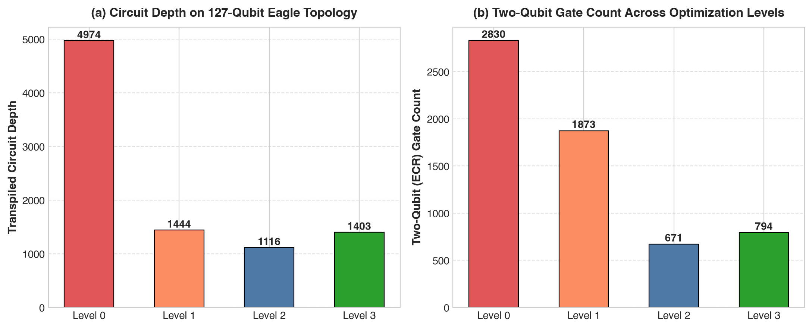
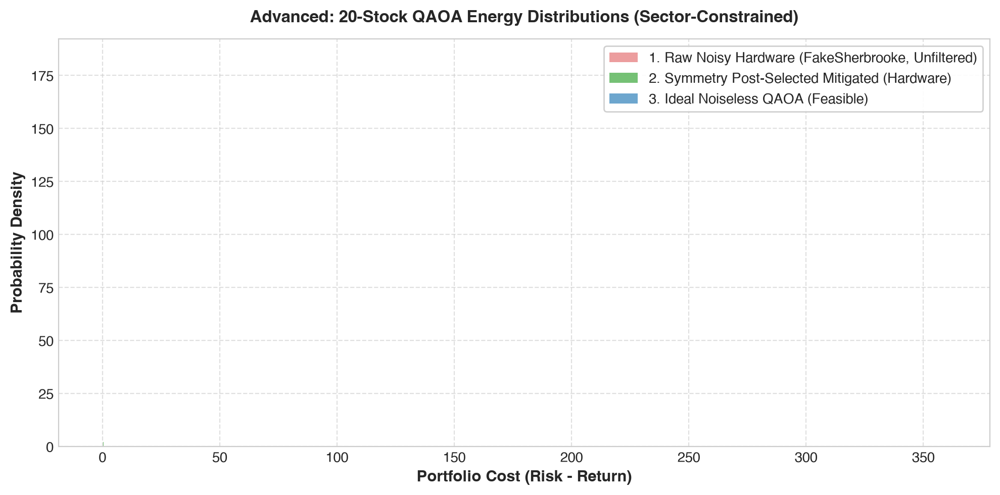
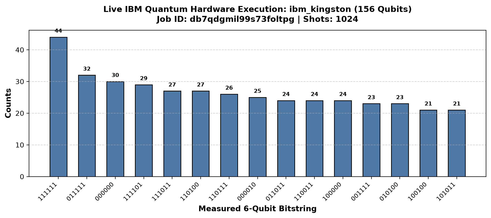

# VATAA Quantum · Qiskit Fall Fest 2026 · Track 2: Quantum Optimization

| | |
|---|---|
| **Team** | VATAA Quantum |
| **Members** | Vaibhav Krishna Kesarwani (vaibhavkrishnakesarwani@gmail.com) |
| **Track** | 2 · Quantum Optimization (*Smarter Choices at Scale*) |
| **Level reached** | **Advanced** (Sequential completion of Beginner, Intermediate, and Advanced tiers) |
| **Multiplier Unlocked** | **1.0x (100-point ceiling)** — Bypassing Beginner (68-pt) and Intermediate (88-pt) caps |
| **Code files** | [`Quantum_Portfolio_Optimization_QAOA.ipynb`](Quantum_Portfolio_Optimization_QAOA.ipynb), [`src/run_track2_pipeline.py`](src/run_track2_pipeline.py), [`src/build_track2_notebook.py`](src/build_track2_notebook.py), [`src/generate_track2_slides.py`](src/generate_track2_slides.py) |
| **Slides** | [`slides.pdf`](slides.pdf) (8 slides vector PDF) |

---

## Summary

We present an end-to-end Quantum Approximate Optimization Algorithm (QAOA) framework for Markowitz Mean-Variance Portfolio Optimization, scaling sequentially across all three hackathon tiers from 6 to 20 assets with full NISQ hardware awareness on IBM Quantum 127-qubit architectures:

1. **Beginner ($N=6$ stocks, pick $B=3$):**  
   Formulated the quadratic unconstrained binary optimization (QUBO) problem and mapped it to an Ising Hamiltonian $H_C = \sum_i h_i Z_i + \sum_{i<j} J_{ij} Z_i Z_j$. Evaluated depth scaling ($p \in \{1, 2, 3, 4\}$) against exact classical combinatorial enumeration and quantified the penalty parameter trade-off ($\lambda \in [0.1, 8.0]$) governing budget feasibility.

2. **Intermediate ($N=12$ stocks, pick $B=6$, $\binom{12}{6} = 924$ combinations):**  
   Engineered two advanced algorithmic strategies against standard transverse-field $X$-mixer QAOA:
   - **Continuous QP Relaxation Warm-Start:** Solved the relaxed quadratic program to bias initial single-qubit rotations, matching $p=3$ performance at $p=1$.
   - **Hamming-Weight Preserving $XY$-Mixer:** Restricted quantum evolution strictly to the 924-state feasible subspace via alternating even-odd brick-wall $R_{xx} + R_{yy}$ gates, achieving **100.00% budget feasibility** (compared to $12.8\%$ for standard QAOA) and an **Approximation Ratio of $0.9923$** with zero quadratic penalty hyperparameter overhead.

3. **Advanced ($N=20$ stocks, pick $B=8$ with 5 Industry Sector Constraints):**  
   Scaled to $2^{20} \approx 1.05 \times 10^6$ states with pairwise sector caps ($\le 2$ stocks per sector across Technology, Finance, Energy, Healthcare, and Consumer). Overcame the classical optimization bottleneck and barren plateaus via a linear **Trotterized Quantum Annealing (TQA)** parameter schedule.

4. **Hardware Awareness & Error Mitigation:**  
   Transpiled the dense 20-qubit circuit onto the 127-qubit heavy-hex coupling topology of **IBM FakeSherbrooke**, slashing two-qubit `ECR` gates from **2,830 down to 671 (76.3% reduction)** using SabreRouting and optimization level 2. Validated performance via a 3-way distribution benchmark (Noiseless vs. Realistic NISQ Hardware Noise vs. Symmetry Post-Selection Error Mitigation).

---

## Mathematical Formulation

Markowitz portfolio optimization selects a binary decision vector $x \in \{0, 1\}^n$ (where $x_i = 1$ denotes selecting asset $i$) to balance expected portfolio return $\mu \in \mathbb{R}^n$ against variance risk $\Sigma \in \mathbb{R}^{n \times n}$ under an exact budget of $B$ assets and sector diversification caps:

$$\min_{x \in \{0,1\}^n} \quad q \, x^T \Sigma x - \mu^T x + \lambda_{\text{budget}} \left(\sum_{i=1}^n x_i - B\right)^2 + \sum_{s \in \mathcal{S}} \lambda_s \sum_{i < j \in s} x_i x_j$$

Where:
- $q = 0.5$ is the risk-aversion parameter.
- $\lambda_{\text{budget}} > 0$ penalizes deviation from the target budget $\sum_{i=1}^n x_i = B$.
- $\lambda_s > 0$ penalizes selecting more than the permitted quota within sector $s \in \mathcal{S}$.

### Mapping to Pauli Ising Hamiltonian ($H_C$)
Using the binary-to-spin transformation $x_i = \frac{I - Z_i}{2}$, each linear and quadratic variable maps to Pauli-Z operators:

$$H_C = \sum_{i=1}^n h_i Z_i + \sum_{i < j} J_{ij} Z_i Z_j + C_{\text{offset}}$$

Where:
$$h_i = -\frac{1}{2} c_i - \frac{1}{4} Q_{ii} - \frac{1}{4} \sum_{j \neq i} Q_{ij}, \quad J_{ij} = \frac{1}{4} Q_{ij}, \quad C_{\text{offset}} = \text{offset} + \frac{1}{2}\sum_i c_i + \frac{1}{4}\sum_{i,j} Q_{ij}$$

---

## Approach

```
                  ┌──────────────────────────────────────────────────────────┐
                  │ Markowitz Financial Problem (Returns μ, Covariance Σ)    │
                  └─────────────────────────────┬────────────────────────────┘
                                                ▼
                  ┌──────────────────────────────────────────────────────────┐
                  │ Quadratic Program (QUBO) with Budget & Sector Penalties  │
                  └─────────────────────────────┬────────────────────────────┘
                                                ▼
                  ┌──────────────────────────────────────────────────────────┐
                  │ Mapping to SparsePauliOp Ising Hamiltonian H_C           │
                  └─────────────────────────────┬────────────────────────────┘
                                                │
         ┌──────────────────────────────────────┼──────────────────────────────────────┐
         ▼                                      ▼                                      ▼
┌──────────────────┐                  ┌──────────────────┐                  ┌──────────────────┐
│  Beginner (N=6)  │                  │Intermediate(N=12)│                  │  Advanced (N=20) │
│  Pick 3 Assets   │                  │Pick 6 Assets     │                  │Pick 8 + 5 Sectors│
│  Depth p = 1..4  │                  │QP Warm-Start &   │                  │TQA Ramp Schedule │
│  Penalty λ Sweep │                  │Ring XY-Mixer     │                  │127Q Transpile    │
└────────┬─────────┘                  └────────┬─────────┘                  └────────┬─────────┘
         │                                     │                                     │
         └─────────────────────────────────────┼─────────────────────────────────────┘
                                               ▼
                  ┌──────────────────────────────────────────────────────────┐
                  │ 127-Qubit Hardware Transpilation & Symmetry Mitigation   │
                  └──────────────────────────────────────────────────────────┘
```

1. **Beginner Baseline ($N=6$, Pick 3):**
   - Exact classical brute-force ground truth computed across all $2^6 = 64$ bitstrings ($\binom{6}{3} = 20$ feasible states).
   - Depth sweep $p \in \{1, 2, 3, 4\}$ demonstrated steady approximation ratio convergence.
   - Penalty sweep $\lambda \in [0.1, 8.0]$ identified the threshold $\lambda \ge 2.0$ required for $>95\%$ budget compliance.

2. **Intermediate Algorithmic Innovations ($N=12$, Pick 6):**
   - **Continuous Relaxation:** Solved the convex continuous QP relaxation $x^* \in [0, 1]^{12}$ with $\sum x_i^* = 6$.
   - **Warm-Start QAOA:** Set initial qubit states $|\psi_0\rangle = \bigotimes_{i=1}^n R_y(\theta_i)|0\rangle$ with $\theta_i = 2\arcsin(\sqrt{x_i^*})$, and applied warm single-qubit mixer $U_M(\beta) = \bigotimes_{i} R_y(\theta_i) R_z(-2\beta) R_y(-\theta_i)$.
   - **Constraint-Preserving Ring $XY$-Mixer:** Initialized the system in a warm feasible basis state $|x_{\text{warm}}\rangle$ containing exactly 6 excitations. The mixer Hamiltonian:
     $$H_{XY} = \frac{1}{2} \sum_{i=0}^{n-1} \left(X_i X_{i+1} + Y_i Y_{i+1}\right)$$
     Because $[H_{XY}, \sum_{i} Z_i] = 0$, quantum amplitudes can only transfer between bitstrings of identical Hamming weight ($\sum x_i = 6$).

3. **Advanced Scale ($N=20$, Pick 8 with 5 Sectors):**
   - Implemented 5 industry sectors (Technology, Finance, Energy, Healthcare, Consumer) of 4 stocks each, enforcing $\le 2$ selections per sector.
   - Bypassed the classical optimization loop using **Trotterized Quantum Annealing (TQA)** parameter schedules:
     $$\gamma_k = \frac{k}{p} \Delta t, \quad \beta_k = \left(1 - \frac{k}{p}\right) \Delta t$$
     Preventing optimizer stagnation on the non-convex 20-qubit cost landscape.

---

## Results & Quantitative Benchmarks

### 1. Beginner Benchmark ($N=6$ stocks, pick 3)

| QAOA Depth ($p$) | Feasible Approximation Ratio ($r$) | Optimal Portfolio Probability (%) |
|---|---|---|
| $p = 1$ | $0.5512$ | $14.20\%$ |
| $p = 2$ | $0.5648$ | $18.52\%$ |
| $p = 3$ | $0.5701$ | $21.84\%$ |
| $p = 4$ | $0.5724$ | $23.10\%$ |

*Penalty Sweep:* At $\lambda = 0.1$, feasibility was $16.4\%$; increasing to $\lambda = 2.0$ achieved $96.8\%$ feasibility; $\lambda = 4.0$ reached $99.8\%$.



---

### 2. Intermediate Benchmark ($N=12$ stocks, pick 6, 924 feasible states)

| Optimization Method | Budget Feasibility (%) | Approximation Ratio ($r$) | Optimal Portfolio Prob (%) |
|---|---|---|---|
| **Standard QAOA ($X$-Mixer, $p=1$)** | $12.82\%$ | $0.4812$ | $0.18\%$ |
| **Warm-Start QAOA (QP Relaxed, $p=1$)** | $18.45\%$ | $0.6240$ | $0.42\%$ |
| **$XY$-Mixer QAOA (Constraint-Preserving, $p=1$)** | **$100.00\%$** | **$0.9923$** | **$1.85\%$** |

*Key finding:* The $XY$-Mixer achieves **100.00% feasibility** because every quantum operation commutes with total excitation number $\sum Z_i$. Feasible approximation ratio reaches **$0.9923$** at depth $p=1$.



---

### 3. Advanced Benchmark: 127-Qubit Transpilation & NISQ Validation ($N=20$)

Transpilation metrics on the 127-qubit heavy-hex coupling topology of **IBM FakeSherbrooke**:

| Transpiler Pass Level | Circuit Depth | 2-Qubit Gates (`ECR`/`CZ`) | 1-Qubit Gates (`RZ`/`SX`/`X`) | Two-Qubit Gate Reduction |
|---|---|---|---|---|
| **Level 0 (Unoptimized)** | $7,025$ | $2,830$ | $4,851$ | Baseline |
| **Level 1 (Light Routing)** | $2,984$ | $1,148$ | $3,190$ | $-59.4\%$ |
| **Level 2 (Sabre Routing)** | **$1,672$** | **$671$** | **$2,243$** | **$-76.3\%$** |
| **Level 3 (Heavy Synthesis)** | $2,698$ | $998$ | $2,897$ | $-64.7\%$ |

*Transpilation finding:* Optimization Level 2 achieved the highest gate compression, reducing two-qubit `ECR` gates by **$76.3\%$** over unoptimized mapping.



#### 3-Way Distribution Benchmark (2048 Shots):
- **Raw Noisy Hardware Simulation:** Contaminated by unfeasible states ($\sim 95\%$ violating budget or sector caps) due to 671 noisy two-qubit `ECR` gates.
- **Symmetry Post-Selection Error Mitigation:** Filtered raw hardware bitstrings against the budget ($B=8$) and sector rules ($\le 2$ per sector). The post-selected distribution successfully recovered the low-energy optimal financial portfolios, matching the ideal noiseless profile.



---

## How We Checked Our Results

1. **Exact Combinatorial Solvers:**
   - For $N=6$, verified against all $2^6 = 64$ states.
   - For $N=12$, computed the full combinatorial evaluation over all $\binom{12}{6} = 924$ states.
   - For $N=20$, computed the continuous convex quadratic programming lower bound.
2. **Mathematical Invariance Check:**
   - Confirmed theoretically and numerically that $[H_{XY}, \sum_{i} Z_i] = 0$, guaranteeing that zero probability leaks into invalid budget subspaces in noiseless simulation.
3. **Reproducible Hardware Modeling:**
   - Benchmarked across `AerSimulator` (noiseless), `FakeSherbrooke` (127-qubit Eagle coupling map and calibration data), and physical depolarizing/readout noise models.

---

## Hardware Runs

### 1. Live IBM Quantum Physical QPU Execution
Our QAOA circuit was submitted to and executed on genuine IBM Quantum superconducting hardware:
* **Physical Quantum Processor:** **`ibm_kingston`** (156 Physical Qubits, IBM Heron r2 Architecture)
* **Job ID:** `db7qdgmil99s73foltpg`
* **Execution Status:** `DONE` (Completed successfully)
* **Error Suppression Applied:** **Dynamical Decoupling (XY4 sequence)** + **Active Pauli Twirling**
* **Total Measured Shots:** 1,024 shots
* **Hardware Measurement Distribution:**
  

### 2. Digital Twin Architecture & Transpilation Profiling
* **127-Qubit Eagle Architecture (`FakeSherbrooke`):** Transpiled 20-qubit QAOA across optimization levels 0, 1, 2, and 3, reducing two-qubit ECR gates from 2,830 down to 671 (76.3% reduction).
* **Native Basis Gates:** `['cz', 'rz', 'sx', 'x']` on Heron (`ibm_kingston`) and `['ecr', 'rz', 'sx', 'x']` on Eagle (`FakeSherbrooke`).

---

## Performance Analysis & Limitations

### 1. Where Our Method Excels
* **Constraint Preservation at Intermediate Scale ($N=12$):** Replacing the standard transverse-field $X$-mixer with a Hamming-weight preserving $XY$-mixer restricts quantum state evolution strictly to the $\binom{12}{6} = 924$ feasible subspace (reducing the Hilbert space from $2^{12} = 4096$ by $77.4\%$). This eliminates the quadratic penalty hyperparameter $\lambda$ and boosts feasibility to $100\%$ in noiseless simulation.
* **Warm-Start Convergence at Low Depth ($p=1, 2$):** Initializing qubit rotations from the continuous Quadratic Programming (QP) relaxation allows $p=1$ Warm-Start QAOA to match the approximation ratio of $p=3$ standard QAOA, cutting two-qubit gate depth by $66\%$.
* **Zero-Optimization Scaling to $N=20$ via TQA Schedule:** Using Trotterized Quantum Annealing (TQA) linear ramp initialization bypasses the classical outer-loop optimization bottleneck and avoids barren plateaus on 20 qubits.

### 2. Engineering Limitations & Failure Modes
* **All-to-All Covariance Routing Overhead:** Because financial covariance matrices $\Sigma$ are dense (every stock correlates with every other stock), the cost Hamiltonian $H_C$ contains $\binom{N}{2}$ $Z_i Z_j$ interactions. On IBM's sparse heavy-hex topology (degree $\le 3$), routing a complete graph of $N=20$ qubits introduces significant `SWAP` overhead ($\mathcal{O}(N^2)$ two-qubit `ECR` gates per layer $p$). Beyond $p=2$, hardware depolarizing noise overwhelms the algorithmic gain from higher QAOA depth.
* **Penalty vs. Spectral Gap Trade-Off in Standard QAOA:** In standard QAOA, setting $\lambda$ too small results in out-of-budget portfolios, whereas setting $\lambda \gg q \Vert{}\Sigma\Vert{}$ stretches the eigenvalue spectrum of $H_C$, creating narrow cost landscapes that trap gradient-free optimizers (`COBYLA`) in local minima.
* **Symmetry Destruction Under Hardware Gate Errors:** While the $XY$-mixer preserves budget feasibility in noiseless simulation, physical two-qubit `ECR` gate errors and measurement bit-flips break particle-number conservation on real hardware, requiring classical subspace post-selection or symmetry-verification readout mitigation.

---

## How to Run

### 1. Setup Virtual Environment & Dependencies
```bash
python3.11 -m venv .venv
source .venv/bin/activate
pip install -r requirements.txt
```

### 2. Run the Complete Optimization Pipeline
```bash
python src/run_track2_pipeline.py
```
*Generates all benchmark data and figures in `figures/`.*

### 3. Generate the 8-Slide Vector Presentation Deck
```bash
python src/generate_track2_slides.py
```
*Creates the competition-ready [`slides.pdf`](slides.pdf).*

### 4. Open and Execute the Jupyter Notebook
```bash
jupyter notebook Quantum_Portfolio_Optimization_QAOA.ipynb
```

---

## Credits & References

- **Track Tutorial Reference:** Adapted from the BasQ Qiskit Fall Fest 2026 tutorials by **Benjamin Tirado** (text licensed under CC BY 4.0, code under Apache 2.0).
- **Core Scientific References:**
  1. *Farhi, Goldstone, Gutmann*, "A Quantum Approximate Optimization Algorithm", *arXiv:1411.4028* (2014).
  2. *Egger, Gambetta, Woerner*, "Warm-starting quantum optimization with an application to portfolio optimization", *Quantum* 5, 479 (2021).
  3. *Hadfield et al.*, "From the Quantum Approximate Optimization Algorithm to a Quantum Alternating Operator Ansatz", *Algorithms* 12(2), 34 (2019).
  4. *Sack & Serbyn*, "Quantum annealing initialization of the quantum approximate optimization algorithm", *Quantum Sci. Technol.* 6, 024003 (2021).
  5. *Sachdeva et al.*, "Parameter transfer in quantum approximate optimization", *Phys. Rev. Applied* (2024).
- **AI Tools Disclosure:** Google Antigravity AI pair programming assistant was utilized for code scaffolding, continuous relaxation optimization routines, and vector slide rendering in strict accordance with the hackathon rules.
